# De Mirai a Skynet

**Lo que ya es real, lo que no, y qué hacer antes de que sea tarde.**

Charla técnica de Joseph Páez (software y seguridad) y José Laica (electrónica y robótica).

---

## Contenido

- `informes/charla-de-mirai-a-skynet-esquema-2026-11-25.md`: esquema, bloques, tabla de fuentes y pendientes.
- `informes/charla-diapositivas-borrador-2026-11-25.md`: borrador por bloque. Cada diapositiva indica su fuente y su estado.
- `evidencia/`: copias de las fuentes citadas. Las copias `-limpia` son las que se citan.
- `assets/banner-mirai-skynet.svg`: portada animada. Cada 20 segundos hay una escena de toma de control: el tinte cambia a rojo, aparece una unidad nueva y el texto pasa a «mando central perdido».
- `demo/enjambre-local.html`: simulación local de un enjambre con mando central, pérdida de mando, retorno a punto seguro y panel de detección. No contiene ataque ni control de hardware.
- `demo/cadena-de-control-defensas.svg`: diagrama de la cadena de control con los cuatro puntos de salvaguarda (autenticación del mando, canal cifrado, geovallado con punto seguro y parada de emergencia independiente de la red).

## Estado de las fuentes

| Símbolo | Significado |
|---|---|
| [P] | Fuente primaria, verificada en el texto |
| [S] | Fuente secundaria o de terceros, con su origen indicado |
| [X] | Sin fuente, o no se usa en la presentación |

Las fuentes primarias que no están en este repositorio (dossier de Symantec y Reglamento (UE) 2024/2847) están en el repositorio de auditoría, en `fuentes/`.

## Reglas de la charla

- La regla de menciones de IA no se aplica a esta charla. Si una fuente menciona la IA, la mención puede aparecer, solo en esta charla.
- Las empresas se nombran como lo que son. Cada afirmación indica quién la hace.
- Las investigaciones propias de los ponentes, si aparecen, lo hacen solo como idea de tesis.
- Solo se cita lo que tiene fuente pública: avisos de CISA y de otros organismos oficiales, informes de fabricantes de seguridad, y casos reportados públicamente.
